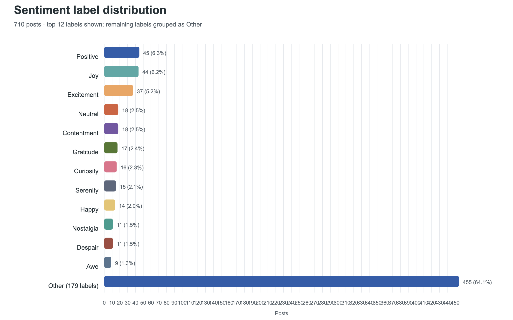

# The Sentiment Signal

**Social media sentiment analysis — Midterm presentation, progress through EDA**

We are exploring how supplied sentiment labels relate to recorded interactions in a synthetic social media dataset, and whether its label support permits a useful text classifier. This repository brings together cleaning, NumPy/Pandas feature exploration, team EDA, and our five-minute presentation. Modeling and hypothesis testing are future work.

## Start here for judges

1. Read [the findings and limitations](reports/eda/findings.md).
2. Browse the executed notebooks: [feature exploration](notebooks/01_feature_exploration.ipynb), [sentiment and time EDA](notebooks/02_sentiment_eda.ipynb), and [platforms and hashtags](notebooks/03_platform_hashtags.ipynb).
3. Download the [presentation slides](presentation/The_Sentiment_Signal_Midterm_Themed.pptx) and [editable speech script](presentation/Midterm_Speech_Script.docx). The [plain-text script](presentation/Midterm_Speech_Script.md) is readable directly on GitHub.
4. Review [our methods](docs/methodology.md), [project status](docs/project_status.md), and [data provenance](data/README.md).



## What we have learned

| Finding | Evidence and implication |
|---|---|
| 732 raw records become 710 cleaned posts | 22 repeated observations removed after normalization; zero missing cells in the cleaned snapshot |
| 191 sentiment labels, including 81 singletons | The original classification target is sparse; a reviewed smaller taxonomy is a proposed next decision |
| Positive is the largest individual label at 45 posts (6.3%) | This supplied label is not the combined count of all positive emotions |
| Interaction distributions overlap | Median differences are descriptive and do not establish significance or causation |
| Instagram mean 67.9, Twitter 62.5, Facebook 62.8 interactions | Interactions means likes plus retweets, with unverified comparability across platforms |
| 287 posts (40.4%) are dated 2023 | Uneven coverage and an incomplete 2023 limit temporal conclusions |

The publisher describes the data as synthetic, ChatGPT-generated content. These findings describe this sample. They do not establish real-world platform behavior. No classifier accuracy, hypothesis-test result, or causal effect has been demonstrated.

## Team

| Member | NetID | Completed contribution |
|---|---|---|
| Yizhou Yan  | yy6074  | Data cleaning and NumPy/Pandas feature exploration |
| Yuwei Zhang | yz13019 | Sentiment distribution, interactions, and time EDA |
| Liwen Xu    | lx2455  | Platform comparisons and hashtag visualization     |

## Reproduce the current analysis

Use Python 3.12. The saved notebooks already include outputs, so judges can inspect them without running code. For a fresh run from this repository root:

```bash
python3 -m venv .venv
source .venv/bin/activate
python -m pip install -r requirements.txt
python scripts/reproduce.py
```

On Windows, activate with `.venv\Scripts\activate` instead. The runner regenerates cleaning outputs, verifies the cleaned data against the committed snapshot, recomputes the core EDA tables, and executes all three notebooks. New outputs are written to `generated/`, which Git ignores. Raw data and committed reports remain unchanged. No Kaggle login or network access is needed after dependencies are installed. See [reproduction details](docs/reproducibility.md) for notebook editing and environment notes.

## Repository guide

| Folder | Contents |
|---|---|
| `data/` | Raw data, canonical cleaned and feature snapshots, dictionary, cached publisher metadata |
| `notebooks/` | Three portable, executed notebooks for the current work |
| `src/` and `scripts/` | Reusable cleaning/EDA code and the reproduction runner |
| `reports/` | Editable Word reports, current findings, six original figures, and supporting tables |
| `presentation/` | Latest themed slides, speech script, deck companion notebooks, and background artwork |
| `archive/` | Earlier initial-analysis and Weeks 1–3 handoffs, including draft label proposals |
| `provenance/` | Source mapping, file checksums, and package validation |

The archive preserves earlier outcomes and proposed plans. Current roles and conclusions are stated here and in `docs/`; archived draft polarity mappings are unreviewed and are not ground truth. Duplicate ZIP handoffs, Office lock files, OS metadata, and older presentation drafts were omitted. The source directory was not changed. Notebook copies were adapted for portability and corrected interpretation, as recorded in [the adaptation log](docs/adaptations.md).

## Feedback we welcome

- Which reduced sentiment taxonomy best fits this sample and its label support?
- Should we add independently annotated real posts for external evaluation?
- What evaluation design best handles repeated text and rare classes?

## Source and reuse

[Kashish Parmar’s Kaggle dataset](https://www.kaggle.com/datasets/kashishparmar02/social-media-sentiments-analysis-dataset/data). The cached publisher metadata lists CC0-1.0 for the dataset. [Data provenance and reuse notes](data/README.md) distinguish the dataset from the team’s code, reports, and presentation; no new blanket license has been assigned to team-authored work.

To put this package online, follow [the upload guide](UPLOAD_TO_GITHUB.md). A public repository URL has not yet been created.
