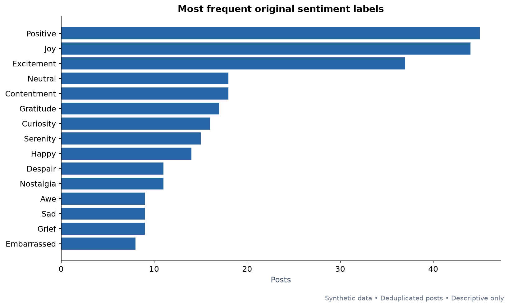
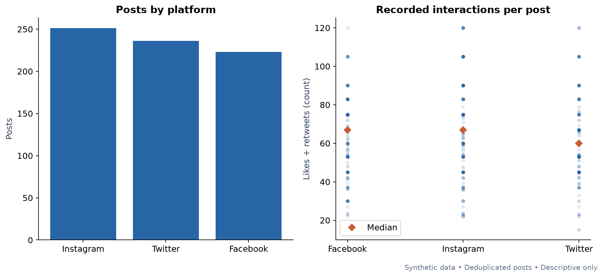
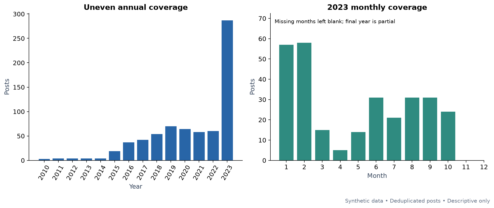
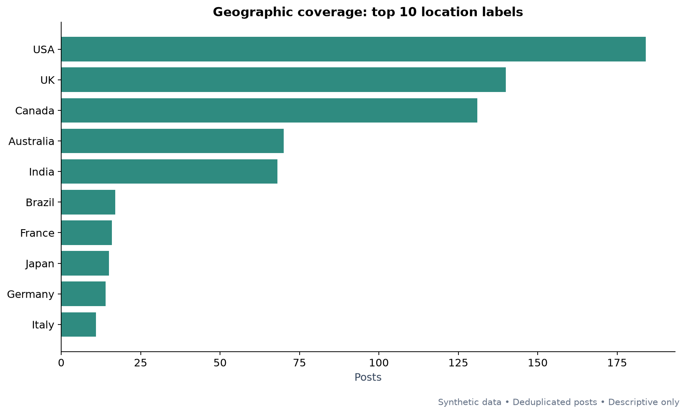
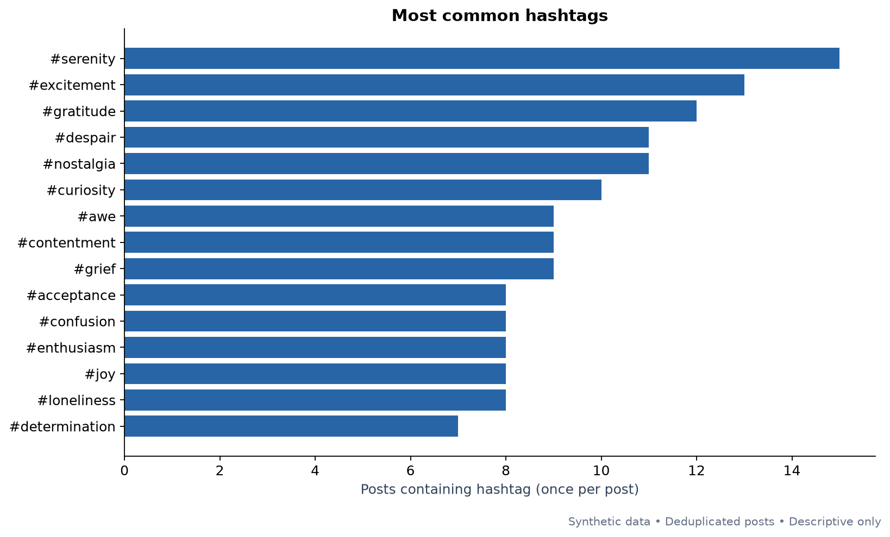
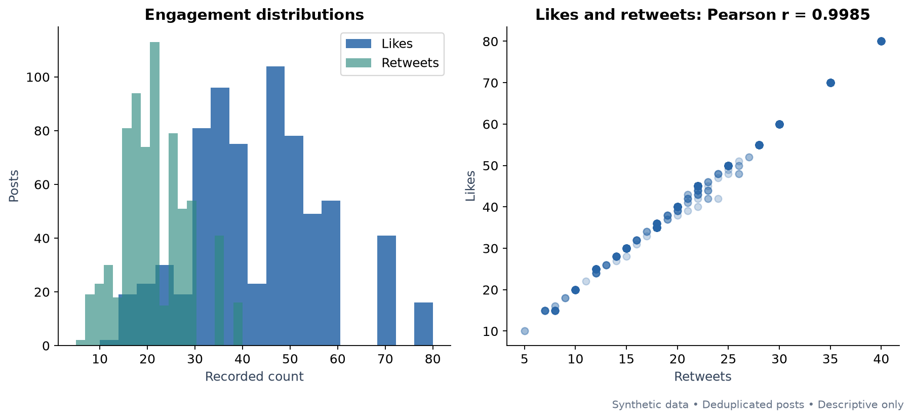
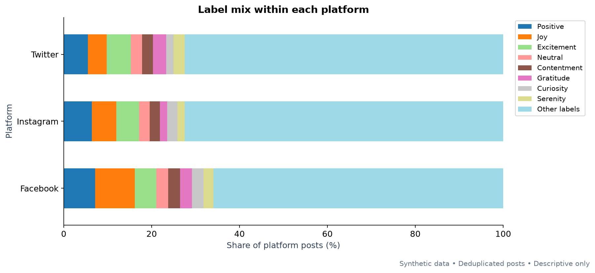
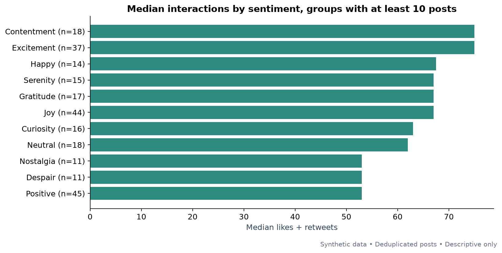

# Social media sentiment: initial analysis

Publisher metadata explicitly identifies the dataset as generated by ChatGPT to simulate social media content. It does not represent real individuals or events. A metadata snapshot is saved in sources/kaggle_metadata.json. The data card describes the fields but does not establish a sampling frame, annotation protocol or timestamp timezone.

## Findings

- The input has 732 rows and 15 columns. Full-record deduplication removes 22 rows (3.0%), leaving 710 posts.
- Trimming whitespace reduces sentiment values from 279 to 191. There are 81 labels with one post and 150 labels with fewer than five posts (271 posts in total).
- The leading labels are Positive: 45 (6.3%), Joy: 44 (6.2%), Excitement: 37 (5.2%). These labels are distinct; Positive is not the total positive-polarity share.
- Platform coverage is Instagram: 251 (35.4%), Twitter: 236 (33.2%), Facebook: 223 (31.4%).
- Posts range from 2010-05-15 through 2023-10-22. 2023 contributes 287 posts (40.4%) and ends in October. Uneven, incomplete coverage prevents a defensible claim about seasonality or population sentiment trends.
- There are 33 location labels. The top five contain 83.5% of posts. The source mixes geographic levels, for example Scotland and UK; country comparisons need explicit harmonization decisions.
- Likes and retweets are nearly redundant: Pearson r=0.9985, Spearman rho=0.9972; 412/710 posts (58.0%) have likes exactly twice retweets. These generated metrics should not be treated as independent evidence of popularity.
- Every retained post has exactly two extracted hashtags. Hashtag count is constant and its correlations are undefined; hashtag identity still varies across posts.
- After record deduplication, 8 rows form 4 repeated text groups. They are retained because other fields differ. Split model data by text_group_id to prevent identical text appearing in both training and evaluation.
- No raw missing cells were found. Parsed timestamps, engagement count validity and year/month/day/hour consistency pass for this file. See the quality audit for exact checks.

## Preprocessing

- Preserve the input CSV. Normalize Unicode to NFC and collapse/trim whitespace in string fields; preserve sentiment semantics and country labels.
- Exclude the two export indices from duplicate detection. Keep the earliest input occurrence of each identical substantive record; save every removed row and its retained source record.
- Parse timestamps without guessing a timezone. Validate nonnegative integer engagement counts and compare supplied calendar parts with parsed dates, then recompute those parts.
- Retain expressive text features (emoji, punctuation and negation). Add lowercase text, text lengths, repeated-text grouping, unique lowercase hashtag tokens and total interactions.
- Compute summaries on the 710 retained posts. Show group sizes and both means and medians. Hashtags are counted at most once per post, and percentages can sum above 100% because posts have multiple hashtags.
- Use full original sentiment labels for EDA. Other labels in the stacked chart is a display remainder, not a training class. No stemming, stopword deletion, balancing, vectorizer fitting or model training is performed.

## Charts

The top 15 original labels show fragmentation. Synonyms such as Happy and Happiness remain separate until a reviewed mapping is approved.

Platform post counts and recorded interaction distributions. Orange diamonds indicate medians; overlaid observations can overlap.

Annual and latest-year monthly counts show collection coverage. Blank months are not evidence of zero real-world activity.

The top 10 source location labels show concentration. Smaller groups should not be used to rank real-world countries.

Common hashtags are topics in this dataset. Frequency alone does not establish a hashtag trend or a causal engagement effect.

Engagement fields have an unusually deterministic relationship consistent with the disclosed synthetic origin.

Within-platform percentages use all posts on each platform as the denominator. The remaining labels are combined only for visualization.

Sentiment engagement comparisons retain groups with at least 10 posts and display sample sizes. Differences are descriptive and can reflect label, time and platform composition.

## Recommended next steps

- Define the target with the group: polarity (positive/negative/neutral) or a small set of emotion families. These are different tasks. Review the provided label template with at least two reviewers, record rules and disagreements, and manually inspect text-label consistency.
- Avoid a 191-class supervised model on 710 posts. Singletons cannot appear in both training and held-out evaluation. If broader labels are approved, split by repeated-text group before fitting TF-IDF and a simple classifier; compare against a majority-class baseline and report macro-F1 plus per-class support.
- Fit text processing and any feature selection on training data only. Keep supplied sentiment and any sentiment-derived feature out of predictors. Use hashtags only if they will be available at prediction time, and compare a text-only model with a version that removes explicit hashtag cues.
- For exploratory comparisons, retain counts alongside percentages, inspect small groups and use the duplicate-sensitivity table. A minimum group size such as 10 is a display filter, not proof of statistical reliability.
- Use a documented real-world, independently annotated dataset if the final project aims to make claims about actual public sentiment, geographic differences or platform behavior.

Source: [Kaggle dataset](https://www.kaggle.com/datasets/kashishparmar02/social-media-sentiments-analysis-dataset/data). See sources/kaggle_metadata.json for the synthetic-origin disclosure.
