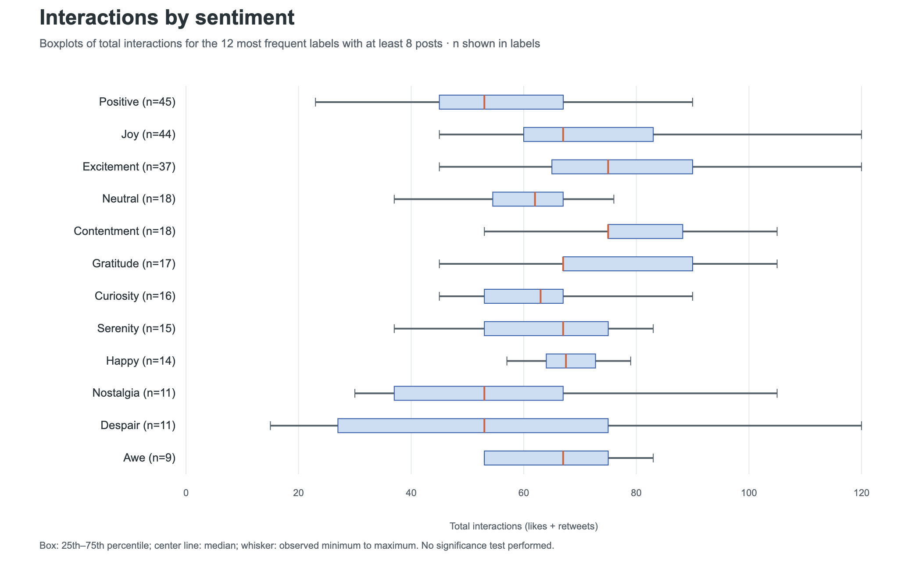
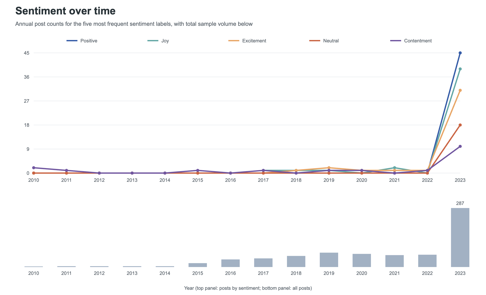
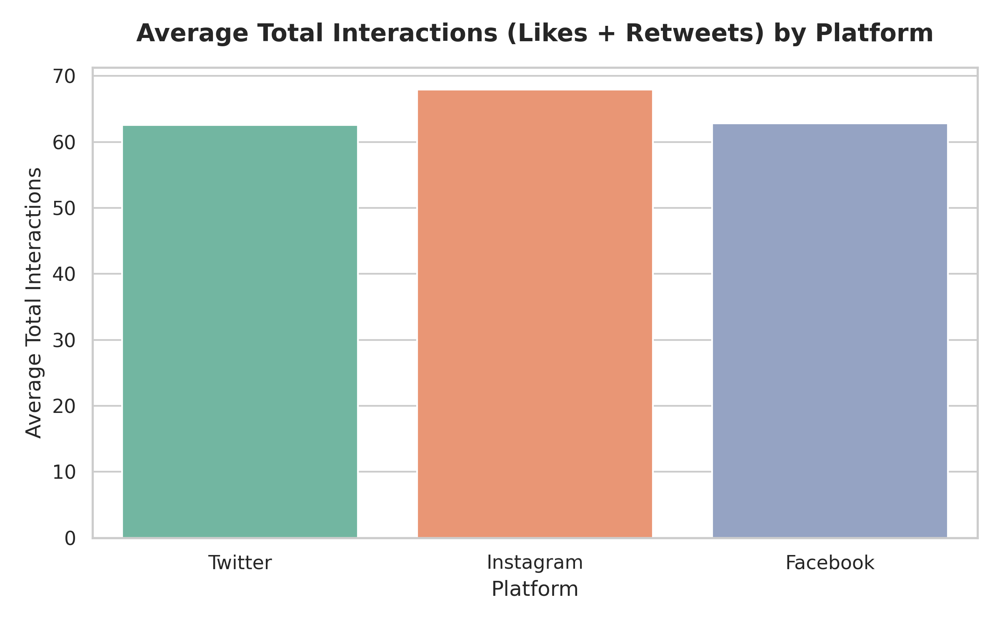
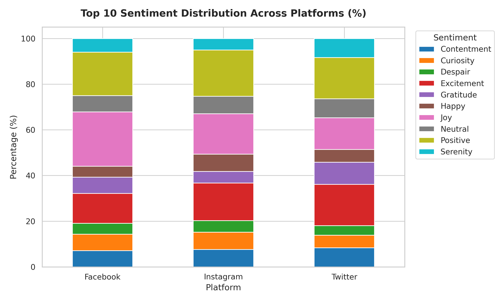
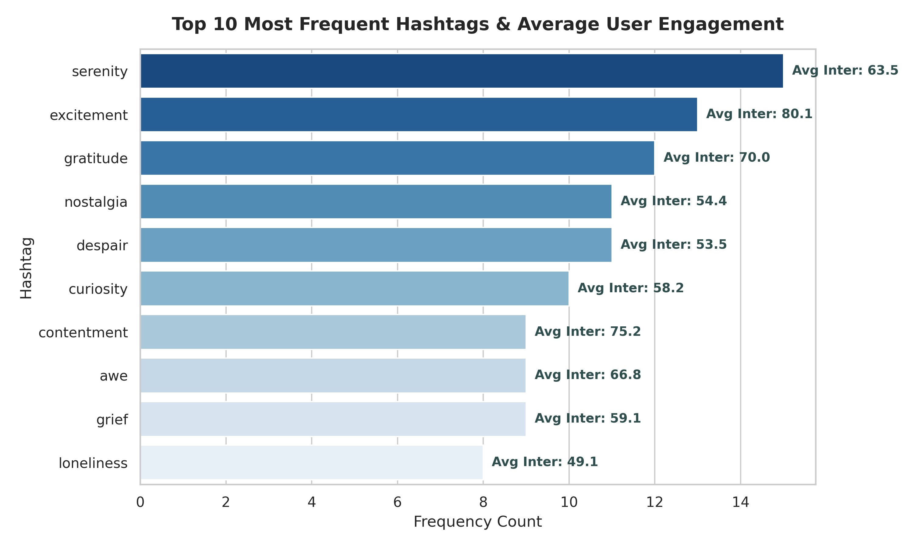

# Midterm findings

The shared input contains 710 retained posts and 26 columns. The cleaning process removed 22 repeated observations from 732 raw records after whitespace and Unicode normalization. Original sentiment labels and expressive text were preserved. All copies of the cleaned CSV in the source project had the same SHA-256.

## Labels and classification feasibility

There are 191 supplied labels and 81 appear once. Positive is the largest individual label with 45 posts, or 6.3%. The top twelve labels cover 255 posts (35.9%); the other 179 labels cover 455 (64.1%). Other is only a visual aggregation. It is not a model class. The team proposes reviewing a smaller target taxonomy before fitting models.

## Interactions and sample context

Interactions is defined as likes plus retweets. Among selected frequent labels, median interactions are 75 for Contentment and Excitement, 67 for Joy, 62 for Neutral, and 53 for Despair and the individual Positive label. The full distributions overlap. These summaries do not establish a significant difference or a causal effect.

Instagram has 251 posts and a mean of 67.9 interactions; Twitter has 236 and a mean of 62.5; Facebook has 223 and a mean of 62.8. Exposure, impressions and a platform-comparable definition of retweets are unavailable. These are count summaries, not engagement rates.

The serenity hashtag appears in 15 posts and excitement in 13. Mean interactions are about 63.5 and 80.1 respectively. Groups overlap, support is small, and no hypothesis test has been run. The word drive and the phrase significantly higher are not supported by this descriptive analysis.

## Platform sentiment denominator

Liwen’s original stacked chart filters to ten supplied labels before normalizing within platform. The denominators are Facebook 84, Instagram 79, and Twitter 72, totaling 235 posts (33.1% of the full data). It is not the complete platform sentiment distribution. A frequency tie at the cutoff means the original plotted selection includes Despair rather than Nostalgia. The portable notebook fixes that selection explicitly. Serenity’s subset share is not higher on Facebook/Instagram than Twitter, so the original generalized platform preference statement is not retained.

## Time coverage

Dates span 15 May 2010 through 22 October 2023. In 2023 there are 287 posts, 40.4% of all records. Increases in individual label counts accompany this larger sample volume. The dataset does not establish a population-level sentiment trend or seasonality.

## Six original figures

### Yuwei

### Liwen

Original figures are preserved. Their CSV inputs and independently verified supplementary summaries are in [tables](tables/). The supplied [original findings](original_findings.md) remain available as a historical record. Happy’s median is 67.5 in the table; the original text rounded it to 67. The current analysis uses the tabulated value when needed.

## Limits and next steps

The publisher describes synthetic ChatGPT-generated content. The sampling design, source timezone, and independent annotation protocol are unknown. No trained classifier or hypothesis test is claimed. Next steps are a reviewed target taxonomy, majority-class and simple text baselines, grouping identical text before splits, fitting text processing only on training data, and evaluating macro-F1 with per-class support. External evaluation on real annotated data is a feedback question.
