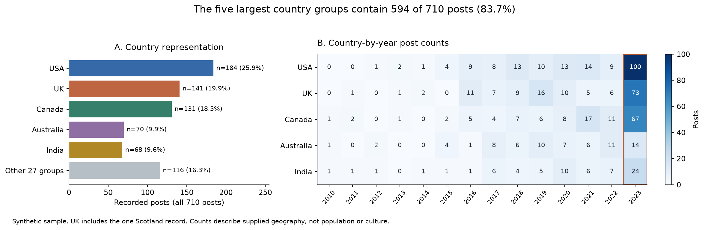
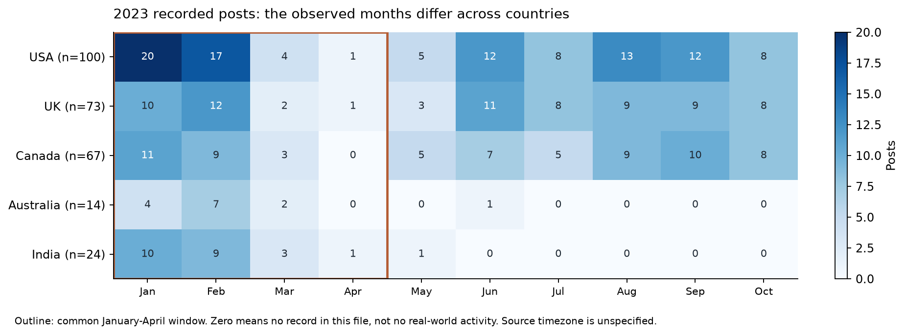
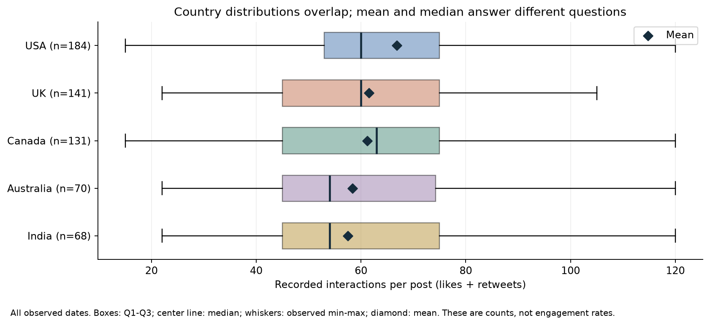
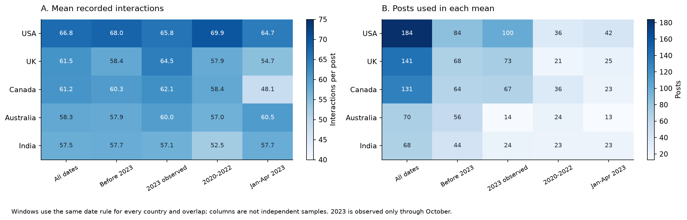
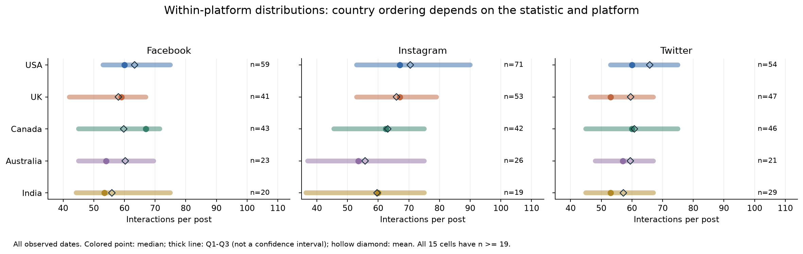

# Country comparisons before sentiment adjudication

**Analysis complete; independent team review pending.**

## Scope and completion status

We completed the label-independent country analysis on 27 November 2026, using the canonical 710-post synthetic snapshot. This report is ready for Liwen's independent calculation/interpretation review; it is not a record of team approval. We did not create reviewed sentiment labels, train a classifier, or run significance tests. All country-level means and proportions use the posts retained in the explicitly named window. UK includes the one Scotland source record, while the original country column is preserved.

## Finding 1: support and calendar coverage limit country comparisons

The five largest groups account for 594/710 posts (83.7%); the other 27 groups contain 116 posts. USA, UK and Canada have 100/184 (54.3%), 73/141 (51.8%) and 67/131 (51.1%) of their posts in 2023, versus 14/70 (20.0%) for Australia and 24/68 (35.3%) for India. Even within 2023 the observed endpoints differ: India's last record is in May and Australia's in June, while the other three groups extend into October. Zero records do not establish zero activity or a known collection interval. Alternative explanation: different observed years/months, rather than geography, can change an aggregate comparison. Sensitivity: we also use before-2023, 2020-2022 and January-April 2023 windows, selected from date support rather than favorable interaction results. January-April is a common calendar restriction, not proof of complete or random sampling.

| country_analysis | posts | first_record | last_record |
| --- | --- | --- | --- |
| USA | 100 | 2023-01-15 12:30:00 | 2023-10-20 14:15:00 |
| UK | 73 | 2023-01-10 16:20:00 | 2023-10-22 20:45:00 |
| Canada | 67 | 2023-01-15 08:45:00 | 2023-10-21 17:30:00 |
| Australia | 14 | 2023-01-15 19:55:00 | 2023-06-15 16:20:00 |
| India | 24 | 2023-01-07 03:30:00 | 2023-05-06 07:20:00 |

## Finding 2: distributions overlap and the headline depends on the statistic

Across all observed dates, USA has the largest mean (66.80 recorded interactions), but Canada has the largest median (63, versus 60 for USA/UK). The middle halves of all five distributions overlap. The summaries below show the entire retained group; no engagement outlier is removed. Alternative explanation: a mean can be influenced by the upper tail and by the mixture of posts. Sensitivity: display medians, IQRs and observed ranges as well as means, then compare the same countries within each platform. Conclusion: these are overlapping distributions in this sample, not evidence that one country's population is more engaged.

| country_analysis | posts | mean_interactions | median_interactions | q1_interactions | q3_interactions |
| --- | --- | --- | --- | --- | --- |
| USA | 184 | 66.8 | 60.0 | 53.0 | 75.0 |
| UK | 141 | 61.52 | 60.0 | 45.0 | 75.0 |
| Canada | 131 | 61.2 | 63.0 | 45.0 | 75.0 |
| Australia | 70 | 58.34 | 54.0 | 45.0 | 74.25 |
| India | 68 | 57.5 | 54.0 | 45.0 | 75.0 |

## Finding 3: some descriptive patterns persist, but lower-country ordering changes

USA has the highest mean in all three full-period platform subsets and all five specified date windows. Other comparisons change: UK exceeds Canada in the full-period mean (61.52 vs 61.20), but Canada exceeds UK before 2023 (60.27 vs 58.37). In January-April 2023, Canada has a mean of 48.09 (n=23), compared with 62.09 over all its observed 2023 posts (n=67). Reweighting the five groups to one common full-period platform mix changes each mean by at most 0.167 interactions per post. This small adjustment is a null sensitivity result worth retaining; it does not show that platform, time, wording or sampling can never matter. We also publish separate common pre-2023/2023 weighting. Neither adjustment is a joint platform-by-time adjustment. Conclusion: the USA mean pattern is descriptively consistent across the specified views, while a complete country ranking is not stable.

## Support guardrails and sensitivity limits

All 15 full-period country-by-platform cells have at least 19 records. Across the finer windows, 27 of the 75 main-group platform-window cells have fewer than 10 posts. For example, Australia in observed 2023 has Facebook/Instagram/Twitter counts of 6/4/4; Canada in January-April has only 2 Instagram records. The n<10 marker is a disclosure convention, not a statistical validity threshold. Sparse cells remain in the support tables and any descriptive weighting; no missing stratum is imputed or silently dropped. No separately adjusted country claim is made for an absent stratum, and no joint platform-by-year standardization is attempted. Keeping one source-order record per exact normalized text group changes the main-country means by at most 0.324 interactions; this is a sensitivity check, not a replacement cleaned dataset, and it does not detect paraphrased synthetic templates.

| window | country_analysis | platform | posts |
| --- | --- | --- | --- |
| 2023_observed | Australia | Facebook | 6 |
| 2023_observed | Australia | Instagram | 4 |
| 2023_observed | Australia | Twitter | 4 |
| 2023_observed | India | Facebook | 6 |
| 2023_observed | India | Instagram | 5 |
| 2020_2022 | Australia | Facebook | 8 |
| 2020_2022 | Australia | Instagram | 7 |
| 2020_2022 | Australia | Twitter | 9 |
| 2020_2022 | Canada | Facebook | 9 |
| 2020_2022 | Canada | Twitter | 8 |
| 2020_2022 | India | Facebook | 8 |
| 2020_2022 | India | Instagram | 8 |
| 2020_2022 | India | Twitter | 7 |
| 2020_2022 | UK | Facebook | 8 |
| 2020_2022 | UK | Instagram | 8 |
| 2020_2022 | UK | Twitter | 5 |
| 2020_2022 | USA | Twitter | 7 |
| 2023_Jan_Apr | Australia | Facebook | 5 |
| 2023_Jan_Apr | Australia | Instagram | 4 |
| 2023_Jan_Apr | Australia | Twitter | 4 |
| 2023_Jan_Apr | Canada | Instagram | 2 |
| 2023_Jan_Apr | Canada | Twitter | 8 |
| 2023_Jan_Apr | India | Facebook | 6 |
| 2023_Jan_Apr | India | Instagram | 5 |
| 2023_Jan_Apr | UK | Facebook | 6 |
| 2023_Jan_Apr | UK | Twitter | 9 |
| 2023_Jan_Apr | USA | Twitter | 9 |

## Independent arithmetic review of existing platform/hashtag outputs

The saved country counts, platform-year coverage, full-platform counts/means, selected-label platform percentages and hashtag counts/means reconcile to the canonical file. Liwen's selected-label composition chart uses only 235 posts: Facebook 84, Instagram 79 and Twitter 72, not all 710 posts. Every retained post has two hashtags, so this dataset cannot compare presence versus absence of hashtags. The 975 hashtag identities can overlap within posts; high means for rare tags are not significance or causal effects. No with/without-hashtag classifier result is available to review. This arithmetic audit is not independent approval by Liwen or a review of future model results.

| platform | all_platform_posts | mean_interactions | selected_label_posts | selected_share_of_platform_pct |
| --- | --- | --- | --- | --- |
| Facebook | 223 | 62.82 | 84 | 37.67 |
| Instagram | 251 | 67.92 | 79 | 31.47 |
| Twitter | 236 | 62.55 | 72 | 30.51 |

## What remains dependent on the team

Yizhou must provide the versioned independent review records and adjudicated decisions before we can finish country positive/negative/neutral proportions, exclusion rates and reviewed-label platform/time checks. We have not inferred these from the 191 supplied labels. Yuwei's human-review assignments (B/C independent review and pilot/A disagreement adjudication) remain unperformed here. Liwen should verify the new calculations and interpretations; the team must approve final claims and select country figures for the presentation. This report describes supplied geography and recorded interaction counts in synthetic posts, not measured culture, causal effects or exposure-normalized engagement rates.

## Reproduction and source version

Base repository commit: 30b74f76653a6af56f558c264107a466f0f13571. Cleaned CSV SHA-256: 4c38dc7cc2a8a06a96c13e989541c024ce31e9ee6af890a5f429fbe1f892ec6a. Run python scripts/country_comparisons.py and python scripts/check_country_comparisons.py from the repository root. Open notebooks/04_country_comparisons.ipynb for the walkthrough. New generated outputs live in generated/final/country_label_independent; the tracked publication copy lives beside this report. Counts for all 32 country groups, including zero-filled country/platform/window cells, are retained in tables/. The manifest records the runtime versions, source hash, windows, disclosure rule and validation status.
